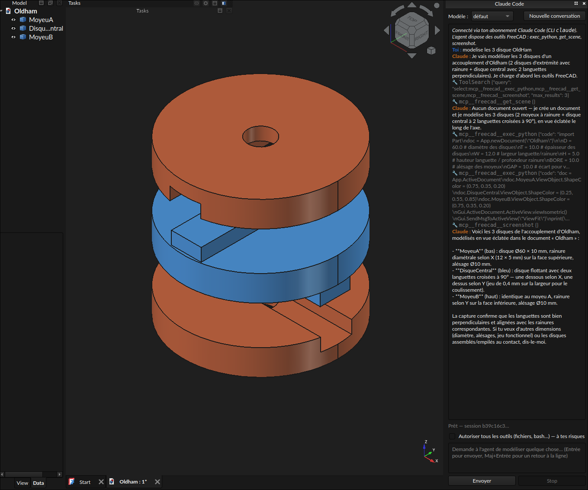

# Claude Code Connector for FreeCAD (unofficial)

[](https://github.com/jacquesh82/FreeCAD-ClaudeCode/actions/workflows/tests.yml)

An unofficial FreeCAD (≥ 1.1) addon that adds a dockable **AI agent chat
panel**: an AI agent that drives FreeCAD for you — creating objects, editing
documents, inspecting the scene, and visually checking its own work with
3D-view screenshots. Two agent CLIs are supported: **Claude Code** and
**ZCode**. This is a third-party project and is not affiliated
with or endorsed by Anthropic or Z.AI.

Authentication goes through your existing subscriptions: the addon launches
the `claude` CLI (Claude Code) or the ZCode CLI bundled with ZCode Desktop,
both already logged in on your machine. No API key required.



*The agent modeling an Oldham coupling from a single chat request, then
verifying the result with a screenshot of the 3D view.*

## Features

- **Dockable chat panel** available in every workbench (docked on the right)
- **Agent selector** — drive FreeCAD with Claude Code or ZCode, each with its
  own conversation
- **Subscription auth** — uses your existing Claude Code login, no API key
- **Agentic tool use** via MCP: the agent can
  - `exec_python` — run Python in the live FreeCAD session
  - `get_scene` — list open documents, objects, bounding boxes, errors
  - `screenshot` — capture the active 3D view and *see* it (visual feedback loop)
- **Conversation continuity** across turns (`--resume <session_id>`)
- **Code review before execution** — every `exec_python` run is displayed
  in full inside FreeCAD and runs only once you approve it; each approved
  run is a single undo step. Automatic execution is an opt-in, off by
  default, confirmed by a warning dialog.
- **Attachments** — paste an image (Ctrl+V), drop files or use
  *Attach file…* to send images, documents or CAD files with your prompt.
- **Consent before anything is sent** — no agent is selected by default; the
  first prompt to a service opens a consent dialog listing exactly what data
  it receives.
- **Restricted toolset by default** — only the three FreeCAD tools (plus
  reading your attachments) are pre-authorized; an explicit opt-in widens
  access to all Claude Code tools (`--dangerously-skip-permissions`). Note:
  this is **not** a sandbox — see [Security notes](#security-notes).
- Model selector (default / sonnet / opus / haiku) for Claude Code, Stop
  button, New conversation

## ZCode support

Selecting **ZCode** in the panel's Agent combo drives FreeCAD with the ZCode
CLI bundled with [ZCode Desktop](https://z.ai) (≥ 3.10, CLI 0.16.x), using
your Z.AI coding plan login. The same three FreeCAD MCP tools and the same
conversation continuity (`--resume <sessionId>`) apply.

How it works, and where it differs from the Claude Code path:

- **Binary detection** (Linux): the addon searches known AppImage locations
  and honors `ZCODE_APPIMAGE` (an AppImage or an explicitly selected mount
  directory). Shared `/tmp/.mount_ZCode-*` names are never auto-discovered.
  Selected files and their ancestors must be owned by you or the system
  administrator and protected against other users' writes. This checks local
  ownership, not vendor signatures. Extraction runs in the background, is
  cancellable and uses FreeCAD's private addon cache.
- **One-time setup**: the ZCode CLI refuses headless prompts until
  `~/.zcode/cli/config.json` selects a model provider. After you have
  consented to the Z.AI service, the addon copies the provider selected in
  ZCode Desktop (`~/.zcode/v2/config.json`) into it at each prompt, so key
  rotation is picked up. Nothing in `~/.zcode` is touched before consent.
  Log in once in ZCode Desktop if this is missing.
- **MCP and system prompt**: the CLI has no `--mcp-config` /
  `--append-system-prompt` flags, so the agent's private working directory
  gets a workspace `.zcode/config.json` (and `.agents/mcp.json`) declaring
  the `freecad` MCP server, plus an `AGENTS.md` with the FreeCAD agent
  instructions. These workspace files do not alter your other projects;
  the CLI login configuration is synchronized as described above.
- **Limitations** (CLI 0.16.x): no model selection (the plan's default model
  is used — the Model combo only affects Claude Code), and headless prompts
  always run with all tools allowed (`--mode yolo`, the CLI default). For
  that reason the panel only sends prompts to ZCode once you have ticked
  "Allow all agent tools" and confirmed the warning; `exec_python` is still
  reviewed inside FreeCAD. ZCode detection is currently Linux-only;
  Windows/macOS fall back to Claude Code.

## Architecture

```
┌─ FreeCAD ────────────────────────────────┐
│  Qt dock panel (panel.py)                │
│    │ prompt + agent    ▲ events          │
│    ▼                   │ stream-json     │
│  claude_runner.py / zcode_runner.py      │──── Claude / Z.AI subscription
│  (QProcess, one process per turn)        │
│                                          │
│  rpc_server.py (TCP on 127.0.0.1, GUI    │
│  thread) ◄── mcp_bridge.py (stdio MCP    │
│              server spawned by the CLI)  │
└──────────────────────────────────────────┘
```

- Each chat turn runs `claude -p --output-format stream-json` or the ZCode
  CLI with `--prompt --output-format stream-json`; the panel streams
  assistant text and tool calls into the history view.
- `mcp_bridge.py` is a dependency-free (stdlib-only) MCP stdio server that
  forwards tool calls over TCP to `rpc_server.py`, a tiny QTcpServer running
  on FreeCAD's GUI thread — so agent code executes safely in the live
  document context.

## Requirements

- FreeCAD ≥ 1.1 (Qt6 / PySide6)
- [Claude Code](https://claude.com/claude-code) installed and logged in
  (`claude`, then `/login`) with a Claude subscription — and/or ZCode
  Desktop installed and logged in with a Z.AI coding plan (Linux)
- A system Python (`python3` on Linux/macOS, `python`/`py` on Windows — the
  MCP bridge uses only the standard library)

Windows, Linux and macOS are supported; Windows support is community-tested
(please report issues).
On Windows, use the native `claude.exe` from the official installer. Batch
shims (`claude.cmd` / `.bat`) are rejected because command-shell quoting
cannot safely preserve all permission flags and arguments.

## Installation

### With the installer script (recommended)

The installer auto-detects your FreeCAD user `Mod` directory, checks the
required FreeCAD version (≥ 1.1), the agent CLIs (`claude` and/or ZCode —
warning only if both are missing) and a Python interpreter for the MCP
bridge, then installs the addon (symlink on Linux/macOS, copy on Windows).

```bash
git clone https://github.com/jacquesh82/FreeCAD-ClaudeCode.git
cd FreeCAD-ClaudeCode
./install.sh                 # Linux/macOS
install.bat                  # Windows
```

Options: `--mod-dir <path>` if auto-detection fails, `--copy` to force a
copy instead of a symlink, `--uninstall` to remove the addon.

#### Installing a missing agent CLI

When an agent CLI is missing, the installer offers to install it
(interactive `y/N` prompt — auto-skipped when not run in a terminal). You
can also force it with flags:

```bash
./install.sh --install-claude   # claude CLI via Anthropic's official installer
./install.sh --install-zcode    # ZCode Desktop AppImage → ~/Applications (Linux)
```

- **Claude Code**: runs `curl -fsSL https://claude.ai/install.sh | bash`
  (npm fallback if curl is absent; PowerShell installer on Windows). Run
  `claude` once afterwards and log in (`/login`) with your subscription.
- **ZCode**: reads the current AppImage URL off the official download page
  and downloads it into `~/Applications` (executable). Launch it once and
  log in with your Z.AI coding plan — the addon detects it automatically
  after that.

Manual equivalents: Claude Code — see
[the docs](https://code.claude.com/docs/en/setup); ZCode Desktop — download
from [zcode.z.ai](https://zcode.z.ai/en/docs/install) (`.AppImage`, `.deb`
or `.rpm`).

### Manual installation

Clone this repository into your FreeCAD user `Mod` directory.

> **Note:** FreeCAD 1.1+ may use a *versioned* user directory. Check the real
> path with `FreeCAD.getUserAppDataDir()` in the Python console — on Linux it
> is typically `~/.local/share/FreeCAD/v1-1/`.

```bash
cd ~/.local/share/FreeCAD/v1-1/Mod   # adjust to your getUserAppDataDir()
git clone https://github.com/jacquesh82/FreeCAD-ClaudeCode.git ClaudeCodeWB
```

Restart FreeCAD. Then either:

1. Select the **Claude Code Connector** workbench, or
2. Use the **Claude Code Connector → Claude Code Connector panel** menu entry.

The panel stays docked and usable across all workbenches.

## Usage

Type a request in the panel, e.g.:

> Model the 3 discs of an Oldham coupling, exploded view, and show me the result.

The agent inspects the scene, executes FreeCAD Python in small steps,
recomputes the document, and can verify its work with a screenshot. Each
time it wants to run code, a dialog shows the complete code; click **Run
this code** or **Deny** (Deny is the default button). A denied run is
reported to the agent, which adapts instead of retrying.

**Attachments**: paste an image into the prompt box (for example a sketch or
a photo of a part), drop files onto it, or click **Attach file…**. The files
are copied into the agent's private directory and listed in the prompt; the
agent reads them with its Read tool (images are seen as images) or, for
`.FCStd` and CAD files, can open them inside FreeCAD. *Clear attachments*
or the Delete key removes them before sending.
Pick the agent with the **Agent** combo at the top of the panel (Claude Code
or ZCode — each keeps its own conversation; switching agents does not reset
the other one's session). `Enter` sends, `Shift+Enter` inserts a newline,
**Stop** aborts the current turn, **New conversation** resets the current
agent's session.

## Data disclosure — read this before your first prompt

Nothing leaves your machine until you choose an agent, consent to the data
it receives, and send a prompt. The consent dialog is shown inside FreeCAD
before the first request to each service (Anthropic for Claude Code, Z.AI
for ZCode), names the service, and lists every kind of data sent; it is
asked again if that list changes. *⋯ → Revoke data consents* resets it.
Once you consent, your prompt **and the tool results the agent produces are
sent to the model provider's API** as part of the agent conversation. That
explicitly includes:

- `get_scene` output: document names, **file paths**, object labels/types
  and bounding boxes;
- **full screenshots of your 3D view** (the PNG is uploaded as an image);
- the Python code the agent writes, anything `exec_python` prints, error
  tracebacks, and your prompt text itself;
- the **full contents of any file or image you attach**.

If your designs are proprietary or confidential, assume the agent may share
the geometry it inspects with the model provider (Anthropic or Z.AI). Do not use this addon on
confidential work if that disclosure is unacceptable.

## Security notes

This addon follows the *AI Agents* requirements proposed for the FreeCAD
Addon Index ([Addon-Academy PR #61](https://github.com/FreeCAD/Addon-Academy/pull/61)).

- **Code approval.** Every `exec_python` run is shown in full in a dialog
  inside FreeCAD and executes only when you click *Run this code*. Each
  approved run is wrapped in one undo transaction. The opt-in "Run the
  agent's code without showing it to me first" skips the dialog: it is off
  by default, resets when you switch agents, requires confirming a warning,
  and displays a red banner while active.
- **This addon is not a sandbox.** Approved code runs **inside FreeCAD with
  your user permissions**. Documents and files the agent reads may contain
  instructions planted by someone else; reviewing the code is your main
  protection. The opt-in "Allow all agent tools" additionally grants the
  CLI unrestricted file and shell access (`--dangerously-skip-permissions`
  for Claude Code); it is required to use ZCode, whose headless mode only
  offers `--mode yolo`.
- **Consent and logins.** No service is selected by default and nothing is
  sent before you consent (see above). The agents use the CLI login already
  on your machine only after that consent; the addon never stores API keys
  of its own.
- **Claude tool restrictions.** Restricted turns explicitly remove built-in
  tools (except Read when attachments are present), load only the addon's MCP
  server and ignore user/project/local settings. Authentication still uses
  the existing CLI login. Existing global allow rules and MCP servers do not
  widen this toolset.
- **Stopping.** Stop revokes the turn's RPC token before killing the CLI's
  process group (POSIX) or private Job Object (Windows). Unchecking "Allow
  all agent tools" during an unrestricted turn also stops it; the warning
  stays visible until it finishes. Code already executing synchronously in
  FreeCAD's GUI thread must finish before the GUI can process Stop.
- **Local RPC server.** Starts at your first prompt (never with FreeCAD),
  listens on `127.0.0.1` only on a random port with no option to bind
  elsewhere, and requires a fresh per-turn secret token on every request. A
  request without the right token, or any input that is not part of the
  protocol, closes the connection. Ended turns lose access immediately, even
  while a code approval dialog is open. Connection count, incomplete-request
  lifetime and input-buffer sizes are bounded.
- **Private files.** The token-bearing MCP configuration, the agent's
  working directory, attachments and screenshots are written under
  FreeCAD's per-user cache directory (`~/.cache/FreeCAD/ClaudeCodeConnector/`
  on Linux) with owner-only permissions, never in a shared temp directory.
  Each runner and FreeCAD instance has its own files. Attachments use
  exclusive random names; secret files are replaced atomically using a
  temporary file private from creation. Runner files are cleaned on shutdown.
- Save your documents before long tasks; the chat history records every
  approved, automatic or denied run.

## Development and tests

Install the optional test dependencies and run the regression suite:

```bash
python3 -m pip install -r requirements-dev.txt
python3 -m pytest -q tests
```

On a minimal or headless Linux system (containers, CI runners), PySide6 also
needs a few system libraries, otherwise importing it fails with
`libEGL.so.1: cannot open shared object file`:

```bash
sudo apt-get install -y libegl1 libgl1 libxkbcommon0 libfontconfig1 libdbus-1-3
```

The suite uses real Qt widgets and processes in offscreen mode, with FreeCAD
and agent services replaced by test doubles. It never sends prompts or reads
your agent credentials. The optional transaction integration test uses the
real FreeCAD library in a separate process and a temporary user directory;
it looks under `/usr/lib/freecad/lib` by default, or at `FREECAD_LIB_DIR`.
It is skipped when that library directory is absent. A separate loopback
transport integration test is skipped if the environment prohibits listening
on local sockets. GitHub Actions runs the Qt/security regressions on Linux,
Windows and macOS on pushes and pull requests
([`.github/workflows/tests.yml`](.github/workflows/tests.yml)); each OS
reports its own status.

## License

MIT — see [LICENSE](LICENSE).
